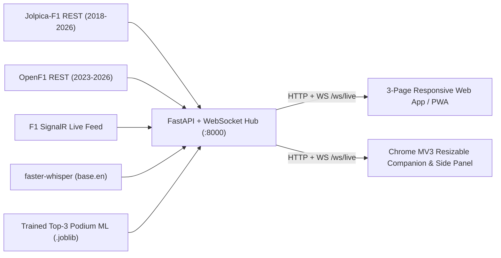

# F1 Pit-Wall — Live Telemetry, Race Strategy & Top-3 Podium ML

**F1 Pit-Wall** is a zero-cost, self-hosted Formula 1 pit-wall companion built as both a **3-page responsive Progressive Web App (PWA)** and a **Manifest V3 Chrome Extension** (launching as a freely resizable floating companion window alongside any live F1 video stream, or docked in Chrome's Side Panel).

---

## Architecture



### Three Dedicated Pit-Wall Pages

1. **Standings & Schedule (`/index.html`)**
   - Full 22-driver **WDC** & 11-team **WCC** championship tables with authentic constructor livery colors.
   - **Next Race** session schedule automatically converted across **IST (India)**, **UK**, and **US (ET / PT)**.
   - **Season Race Results & Schedule** list (completed rounds open final classification; upcoming unrun rounds display `NOT COMPLETED`).
   - Searchable catalog of **26 official F1 2D circuit geometries** (including 2026 **Madring** & **Sepang**) with S1 / S2 / S3 splits.

2. **Live Race & Final Results (`/live.html`)**
   - **Past Race Results:** Official final grid after the chequered flag, complete full-race horizontal **Tyre Stint Timelines** (`S / M / H / I / W` compound badges + lap ages across all 22 cars), **Full Classification** (`POS`, `DRIVER / TEAM`, `GRID`, `TYRE`, `BEST LAP`, `GAP / PTS`), 2D circuit map, **Final Race Podium (P1–P3)** cards, **FIA Race Control**, and **Team Radio** with local **faster-whisper** speech-to-text transcripts.
   - **Live Race Feed:** Connects to F1's unauthenticated SignalR Core stream over `ws://localhost:8000/ws/live` with **zero-flicker keyed DOM reconciliation**, 60 FPS car movement (when GPS is unlocked), `0–60s` **TV Broadcast Sync Delay** slider, and automatic **Next Race Schedule + Upcoming Circuit** standby view when no live F1 session is active on track.

3. **Post-Qualifying Top-3 Predictions (`/predictions.html`)**
   - Evaluates Top-3 podium (`sum = 300.0%`) and race-win (`sum = 100.0%`) probabilities across the full 22-car starting grid using the trained 35-feature **Histogram Gradient Boosting (`hgb`)** model, paired with a centered rotating hourglass computing sequence and 2D circuit map.

### Resizable Floating Companion & Full-Screen Controls
Every page includes two window buttons in the top-right bar:
- **Companion Window (`Pop-Out` icon):** Launches F1 Pit-Wall in an independent, freely resizable floating OS window (`580×860` default) so you can place it side-by-side with your live race broadcast and drag any edge/corner to resize it, or click again to toggle between compact and wide desktop dimensions.
- **Full Screen (`Expand` icon):** Enters or exits native full-screen pit-wall mode (`requestFullscreen`).

---

## Quickstart

### 1. Start the Backend & Web App

```powershell
# From repository root (D:\Projects\F1)
python -m venv .venv
.\.venv\Scripts\Activate.ps1
pip install -r backend/requirements.txt

# Launch FastAPI + WebSocket server on port 8000
python -m uvicorn backend.server.main:app --host 0.0.0.0 --port 8000
```

Open **`http://localhost:8000/`** in any desktop or mobile browser (or click **Install F1 Pit-Wall** in Chrome/Edge's address bar to install it as a standalone chromeless desktop app).

### 2. Load the Chrome Extension (Resizable Floating Window + Side Panel)

1. Open Chrome and navigate to `chrome://extensions`.
2. Enable **Developer mode** (top-right toggle).
3. Click **Load unpacked** and select the `extension/` folder inside this repository.
4. **Click the F1 Pit-Wall toolbar icon** to launch the **freely resizable floating companion window** right next to your live race stream (or right-click the icon → **Open F1 Pit-Wall in Side Panel** to dock it inside Chrome).

---

## Top-3 Podium Machine Learning Pipeline

Both models predict `is_podium = (finishing_position <= 3)` and use iterative water-filling normalization so active drivers stay within `[0.0%, 100.0%]` and sum to **`300.0%`** (`0.0%` for `DNF` / `OUT` cars). Pre-trained `.joblib` artifacts are included in `backend/ml/artifacts/`.

| Stage | Artifact | Dataset | Selected Model | Walk-Forward Log-Loss | Top-1 Podium Hit Rate | Top-3 Accuracy |
|---|---|---|---|---|---|---|
| **Post-Qualifying (`pre_race`)** | `pre_race_model.joblib` | `3,920` driver-races (`194` GPs, 2018–2026) | `HistGradientBoosting` (`35` features) | **`0.2087`** *(vs `0.4149` uniform)* | **`78.6%`** *(`85.7%` in 2026)* | **`68.7%`** *(beats `67.3%` grid baseline)* |
| **Live In-Race (`in_race`)** | `live_race_model.joblib` | `49,426` lap snapshots (`2,604` race-laps, 2025–2026) | `LogisticRegression` (`34` features) | **`0.2204`** *(vs `0.4223` uniform)* | **`88.2%`** | **`70.1%`** *(rises cleanly from Lap 1 to Chequered Flag)* |

To refresh historical data and retrain both models from scratch:

```powershell
cd backend
..\.venv\Scripts\python.exe -m ml.ingest_history -v
..\.venv\Scripts\python.exe -m ml.train --stage both -v
```

---

## Optional Live GPS & Car Telemetry Token

In free unauthenticated SignalR mode (`free_live`), F1's live timing feed provides live positions, gaps, sector times, tyre compounds/ages, weather, FIA Race Control, and Team Radio clips, while locking live `(x, y)` GPS and `CarData.z` telemetry. If you have an F1 session cookie/token, unlock live 60 FPS car movement and 4 Hz MoTeC telemetry splines via:

```powershell
$env:F1_LIVE_TOKEN = "your_cookie_string"
python -m uvicorn backend.server.main:app --host 0.0.0.0 --port 8000
```

---

## REST & WebSocket API Reference

| Method & Path | Purpose |
|---|---|
| `GET /api/health` | Server health, active stream mode, and loaded ML model metadata |
| `GET /api/standings?season=2026` | WDC Drivers' & WCC Constructors' standings + latest qualifying grid |
| `GET /api/next-race?season=2026` | Upcoming Grand Prix session schedule in `IST`, `UK`, `US ET / CT / PT` |
| `GET /api/sessions?year=2026` | Non-cancelled race calendar aligned 1-to-1 with Jolpica + `completed` status |
| `GET /api/race-results?season=2026&round=21` | Final classification after the final lap + full-race tyre stints, fastest sectors, FIA & radio |
| `GET /api/circuits` & `/api/circuits/{id}` | All 26 official 2D circuit geometries (`las_vegas`, `miami`, `madring`, `sepang`, `lusail`, ...) |
| `POST /api/predict/post-quali` | Compute Top-3 podium (`300%`) & win (`100%`) forecast for `{ season, round }` |
| `GET /api/radio/transcribe?url=...` | Local `faster-whisper` (`base.en`) Team Radio speech-to-text with disk cache & SSRF allowlist |
| `POST /api/mode` | Switch stream hub between `"free_live"` and `"replay"` |
| `WS /ws/live` | Real-time WebSocket stream validated against `contract/live_packet.json` |

---

## Automated White-Box & Black-Box Testing

Run the full automated test suite (`contract`, `ml_pipeline`, `stage2_streams`, `server`, `whitebox_suite`, and `blackbox_e2e`) from the repository root:

```powershell
.\.venv\Scripts\python.exe -m pytest backend/tests/ -v
```

---

## License

MIT License — see [LICENSE](LICENSE).
